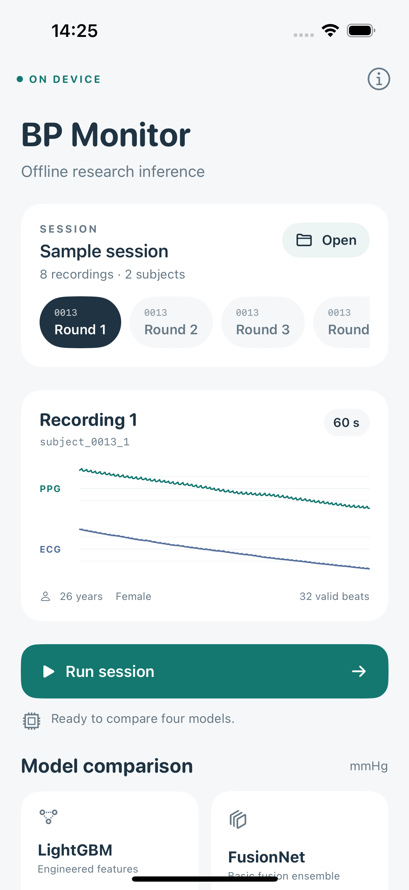
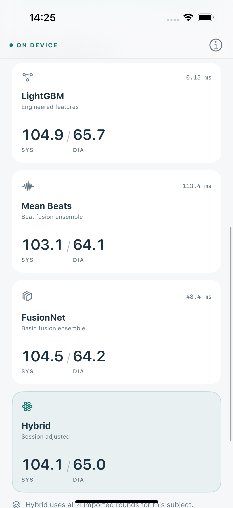

# Validation evidence

Checked locally on 22 October 2026 with Apple Silicon macOS and Xcode 27.1 (27A9275). All numerical errors below are differences from the original implementation or its historical predictions, not errors against measured blood pressure.

| Check | Outcome |
|---|---|
| Original PyTorch → saved Core ML | 10 models × 45 cases passed; maximum difference 0.0000085831 mmHg |
| Native Swift LightGBM → Python LightGBM | 918 inputs × 10 boosters; exact agreement |
| Complete native pipeline → archived predictions | Eight recordings, two complete subjects, all four outputs; maximum difference 0.0000938416 mmHg |
| Missing input handling | Real missing ECG/empty-beat recording plus synthetic beat availability cases passed |
| Import validation | Duplicate IDs/subject rounds, malformed shapes, nonfinite values, unsupported versions and beats without ECG rejected |
| Hybrid session arithmetic | Singleton, incomplete-round centering, subject isolation, order and missing-prediction checks passed |
| iPhone Release build | Passed for generic iOS device, signing disabled |
| Simulator UI test | iPhone 16, iOS 18.6; complete eight-record run and all four calculated outputs passed |

The declared numerical tolerance is 0.005 mmHg. The shared Swift inference engine is the code used by the app. The shipped sample JSON contains inputs only, and no saved predictions are consulted by the app.

## Reports

- [Neural conversion parity](../artifacts/models/neural_parity.json)
- [Tree parity](../artifacts/validation/tree_parity_report.json)
- [Complete native pipeline parity](../artifacts/validation/inference_parity_report.json)
- [Packaged resource SHA-256 hashes](../artifacts/validation/resource_manifest.json)
- [iPhone build log from the delivered project](../artifacts/validation/build-delivered-iphone.log)
- [Simulator UI test log from the delivered project](../artifacts/validation/ui-tests-delivered.log)

## Simulator screenshots

These screenshots were captured by the passing UI test. Displayed timings are simulator timings on this Mac, not physical-iPhone benchmarks.

## Remaining physical-device check

Open the supplied project in Xcode, choose a development Team, connect an iPhone running iOS 17 or later and Run. Replay the sample session and test prepared JSON import through Files. Physical-device installation, thermal behavior and latency have not been measured in this environment.
